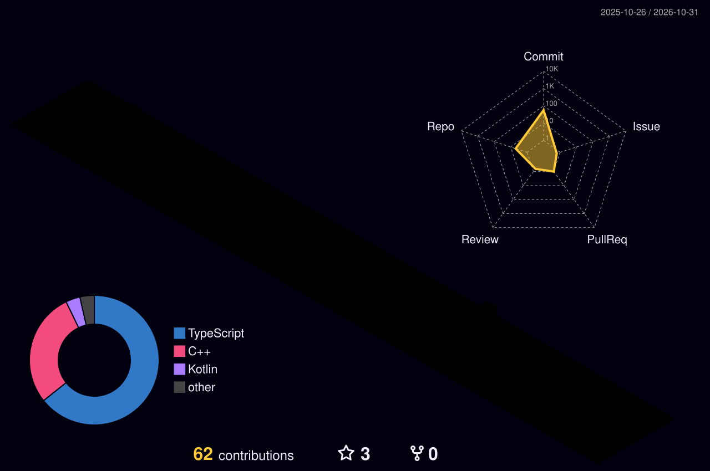

 

## Interests

Robotics, Game

 

## Tried & Learning

**Languages**
 

**Frameworks & Tools**
 

 

## Projects

| Project | Description | Stack |
|---|---|---|
| [**boxbox**](https://github.com/syc030403/boxbox) | F1 2026 시즌 트래커 안드로이드 앱 (Jolpica API) |  |
| [**go2_control_cpp**](https://github.com/syc030403/go2_control_cpp) | Unitree GO2 웨이포인트 기록·자율 주행 — 2025 CO-SHOW 4족보행로봇 경진대회 |   |
| [**igolnik-tracker**](https://github.com/syc030403/igolnik-tracker) | Escape from Tarkov 한국어 유틸 — 탄약 성능표 + 아이템 시세 |  |
| [**minecraft-devops**](https://github.com/syc030403/minecraft-devops) | 공부를 위한 마인크래프트 서버 구축 |  |

 

## GitHub Stats

  

